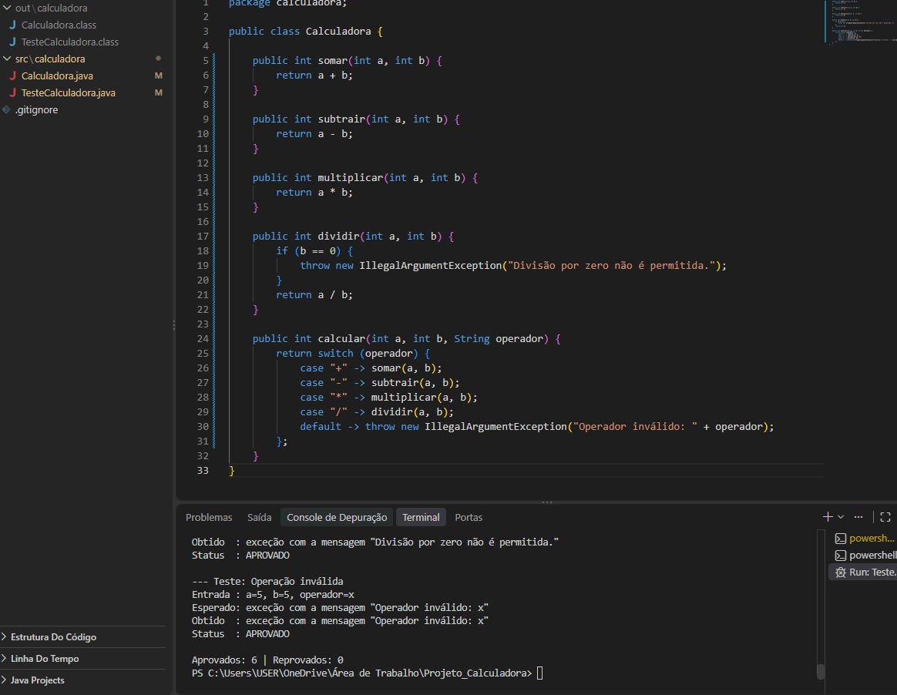
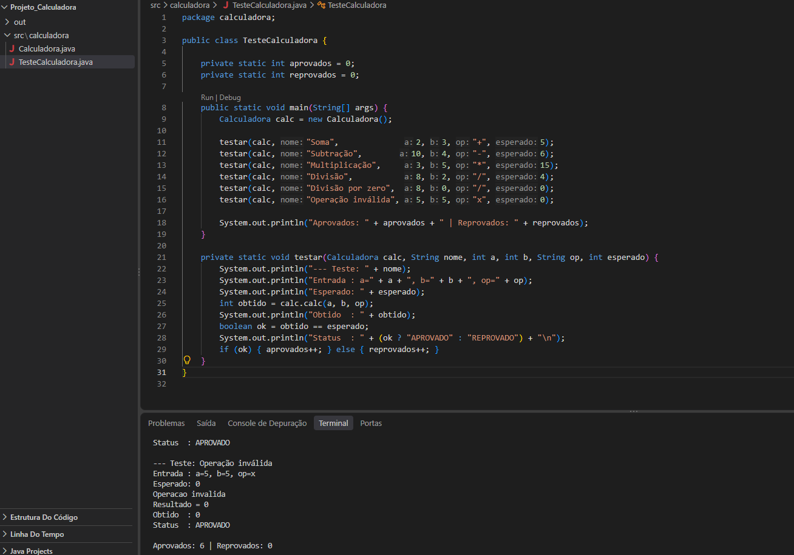
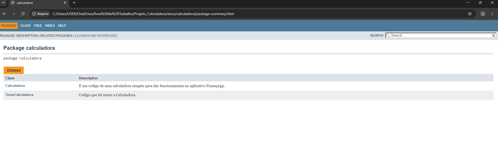
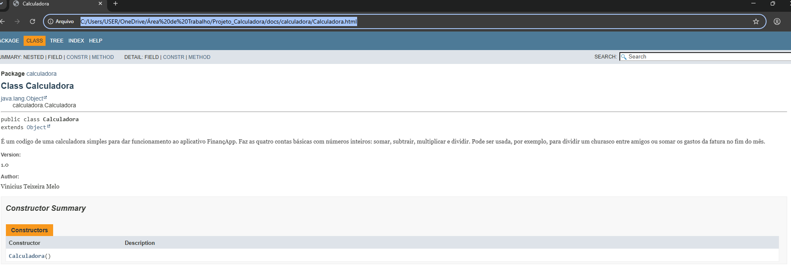

# Projeto Calculadora — FinançApp

> Projeto acadêmico desenvolvido com foco em Qualidade de Software, Testes, Refatoração, Documentação e Versionamento.

---

## 1. Identificação do Projeto

**Projeto:** Projeto Calculadora  
**Contexto:** FinançApp  
**Aluno:** Vinicius Teixeira Melo  
**RA:** 251136  
**Curso:** Análise e Desenvolvimento de Sistemas (ADS)  
**Turma:** AS406TSN4  
**Disciplina:** UX/UI e Testes de Software  
**Professor:** Daniel Ohata  
**Semestre:** 2026.2

---

# 2. Visão Geral

O projeto é um módulo de cálculos matemáticos básicos em Java, criado para a startup fictícia **FinançApp**, um aplicativo de controle de finanças pessoais.

Ele pode ser usado em funcionalidades como:

- orçamento mensal;
- divisão de despesas;
- projeções financeiras;
- cálculos auxiliares.

Além de calcular corretamente, o projeto aplica práticas de qualidade de software: testes, tratamento de erros, refatoração, documentação e versionamento.

---

# 3. Problema

A equipe do FinançApp precisava de um módulo matemático reutilizável que não só funcionasse, mas também fosse fácil de ler, testar, documentar e manter. O desafio foi entregar uma calculadora funcional aplicando boas práticas de Engenharia de Software.

---

# 4. Objetivo

## 4.1 Objetivo Geral

Desenvolver uma calculadora em Java aplicando práticas de qualidade, testes, documentação, refatoração e versionamento.

## 4.2 Objetivos Técnicos

- implementar as operações matemáticas básicas;
- tratar entradas inválidas;
- impedir a divisão por zero;
- criar testes unitários;
- refatorar o código sem alterar o resultado das operações;
- documentar classes e métodos com JavaDoc;
- gerar a documentação em HTML;
- usar Git e GitHub, com commits e branches organizados;
- manter a documentação técnica neste README.

---

# 5. Escopo Funcional

| ID   | Funcionalidade       | Descrição                        | Status |
| ---- | -------------------- | -------------------------------- | ------ |
| RF01 | Soma                 | Soma dois números inteiros       | ✅ |
| RF02 | Subtração            | Subtrai dois números inteiros    | ✅ |
| RF03 | Multiplicação        | Multiplica dois números inteiros | ✅ |
| RF04 | Divisão              | Divide dois números inteiros     | ✅ |
| RF05 | Validação de divisão | Impede divisão por zero          | ✅ |
| RF06 | Operação inválida    | Trata operadores não suportados  | ✅ |

---

# 6. Requisitos Não Funcionais

| ID    | Categoria      | Requisito                                                  |
| ----- | -------------- | ---------------------------------------------------------- |
| RNF01 | Qualidade      | O código deve possuir organização e legibilidade           |
| RNF02 | Testabilidade  | As operações devem possuir testes                          |
| RNF03 | Manutenção     | O código deve permitir refatoração sem alteração funcional |
| RNF04 | Documentação   | Classes e métodos devem possuir JavaDoc                    |
| RNF05 | Versionamento  | O projeto deve utilizar Git e GitHub                       |
| RNF06 | Confiabilidade | Erros não devem interromper inesperadamente a execução     |

---

# 7. Tecnologias Utilizadas

| Tecnologia         | Versão   | Utilização                          |
| ------------------ | -------- | ----------------------------------- |
| Java               | 17       | Desenvolvimento                     |
| JDK                | 17.0.12  | Compilação                          |
| Git                | 2.56.0   | Controle de versão                  |
| GitHub             | —        | Repositório remoto                  |
| JavaDoc            | —        | Documentação                        |
| Visual Studio Code | —        | Ambiente de desenvolvimento         |

Os testes foram feitos em uma classe Java própria (`TesteCalculadora`), executada pelo terminal, sem biblioteca externa.

---

# 8. Estrutura do Projeto

```
projeto_calculadora/
│
├── src/
│   └── calculadora/
│       ├── Calculadora.java
│       └── TesteCalculadora.java
│
├── docs/
│   └── index.html
│
├── images/
│   ├── testes/
│   └── javadoc/
│
├── README.md
└── .gitignore
```

---

# 9. Explicação das Operações

A classe `Calculadora` (pacote `calculadora`) recebe dois números inteiros e um operador. O método `calcular(a, b, operador)` escolhe a conta certa e devolve o resultado.

| Operador | Método        | Exemplo  | Resultado |
| -------- | ------------- | -------- | --------- |
| `+`      | `somar`       | 2 + 3    | 5         |
| `-`      | `subtrair`    | 10 - 4   | 6         |
| `*`      | `multiplicar` | 3 * 5    | 15        |
| `/`      | `dividir`     | 8 / 2    | 4         |

**Tratamento de erros:**

- **Divisão por zero:** o método `dividir` lança uma exceção com a mensagem `Divisão por zero não é permitida.`
- **Operador inválido:** o método `calcular` lança uma exceção com a mensagem `Operador inválido: x` (onde `x` é o operador enviado).

Como os números são inteiros, a divisão devolve só a parte inteira (por exemplo, 8 / 3 resulta em 2).

---

# 10. Testes

A classe `TesteCalculadora` executa 6 testes. Para cada um, mostra a **entrada**, o **resultado esperado** e o **resultado obtido**.

| Teste             | Entrada          | Esperado                              | Obtido                                | Status    |
| ----------------- | ---------------- | ------------------------------------- | ------------------------------------- | --------- |
| Soma              | 2 + 3            | 5                                     | 5                                     | Aprovado  |
| Subtração         | 10 - 4           | 6                                     | 6                                     | Aprovado  |
| Multiplicação     | 3 * 5            | 15                                    | 15                                    | Aprovado  |
| Divisão           | 8 / 2            | 4                                     | 4                                     | Aprovado  |
| Divisão por zero  | 8 / 0            | Divisão por zero não é permitida.     | Divisão por zero não é permitida.     | Aprovado  |
| Operação inválida | 5 x 5            | Operador inválido: x                  | Operador inválido: x                  | Aprovado  |

**Taxa de sucesso:** 6 de 6 testes aprovados (100%).

**Como executar** (na raiz do projeto):

```
javac -encoding UTF-8 -d out src/calculadora/*.java
java -cp out calculadora.TesteCalculadora
```

### Print da execução dos testes (após a refatoração)



### Print da execução dos testes (versão inicial, branch main)



---

# 11. Refatoração

A refatoração foi feita nesta branch (`Refatoracao`), a partir da versão inicial da `main`. As mudanças foram:

- **Extração de métodos:** cada conta saiu do método principal e virou um método próprio (`somar`, `subtrair`, `multiplicar`, `dividir`).
- **Simplificação das condicionais:** a sequência de `if / else if` foi trocada por um `switch`.
- **Nomes mais claros:** o método `calc` passou a se chamar `calcular`, e o parâmetro `op` virou `operador`.
- **Organização:** foi removido o atributo `r`, e os métodos passaram a devolver o resultado diretamente.
- **Tratamento de erros:** em vez de imprimir mensagem e devolver 0, os métodos lançam uma exceção com a mensagem, e o teste trata esses casos.

As operações válidas continuam dando os mesmos resultados, e os 6 testes passam depois da refatoração.

---

# 12. Documentação (JavaDoc)

As classes e os métodos foram documentados com JavaDoc, usando `@author`, `@version`, `@param`, `@return` e `@throws`.

A documentação em HTML fica na pasta `docs/`. Para abrir, use o arquivo `docs/index.html` no navegador.

Para gerar de novo:

```
javadoc -encoding UTF-8 -charset UTF-8 -docencoding UTF-8 -author -version -private -d docs -sourcepath src calculadora
```

### Página do pacote



### Página da classe Calculadora



---

# 13. Repositório e Branches

**Link do repositório:** https://github.com/Vinicius-dev777/Projeto-calculadora

| Branch        | Conteúdo                                                        |
| ------------- | --------------------------------------------------------------- |
| `main`        | Versão inicial da calculadora e testes                          |
| `Refatoracao` | Código refatorado, JavaDoc, pasta `docs/`, prints e este README |